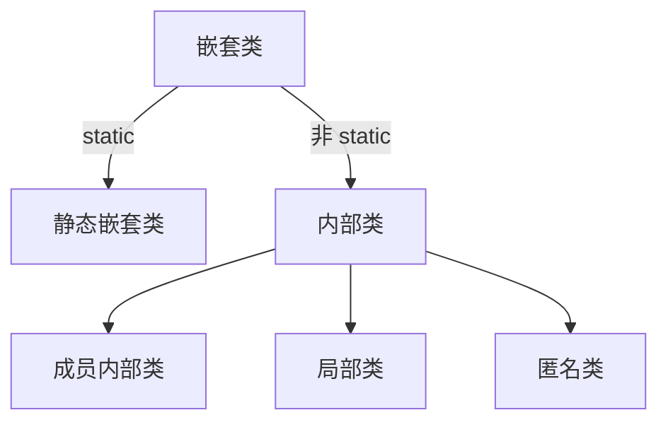

# 第 13 模块：嵌套类

本页覆盖静态嵌套类、成员内部类、局部类和匿名类。

## 四种形式

嵌套类是在另一个类或接口中声明的类：



这里的 `static` 包括隐式声明为静态；例如局部 `record` 和 `enum` 是静态的，不属于内部类。类、接口、枚举和记录都可以作为嵌套类型。

## 静态嵌套类

用 `static class` 声明；创建时不需要 `Employee` 对象：

```java
class Employee {
    private static String company = "Acme";
    private int year = 2020;

    static class Inspector {
        private int marker = 1;

        String company() { return Employee.company; } // 直接访问外部类的静态字段
        int yearOf(Employee employee) { return employee.year; } // 通过对象访问实例字段
        // int year() { return year; } // 错误：没有 Employee 对象
    }

    int markerOf(Inspector inspector) { return inspector.marker; } // 通过对象访问私有字段
}

class StaticExample {
    public static void main(String[] args) {
        Employee.Inspector inspector = new Employee.Inspector();
        System.out.println(inspector.company());                  // Acme
        System.out.println(inspector.yearOf(new Employee()));    // 2020
    }
}
```

在外部使用 `Employee.Inspector` 时，仍须满足访问权限。

例如，按入职年份排序时，静态嵌套比较器可以直接读取员工的私有字段：

```java
import java.util.ArrayList;
import java.util.Comparator;
import java.util.List;

class Employee {
    private int year;

    Employee(int year) { this.year = year; }

    static class YearComparator implements Comparator<Employee> {
        public int compare(Employee a, Employee b) {
            return Integer.compare(a.year, b.year); // 通过员工对象读取私有字段
        }
    }

    public static void main(String[] args) {
        List<Employee> employees = new ArrayList<>(List.of(
                new Employee(2020), new Employee(2018)));
        employees.sort(new YearComparator());
        for (Employee employee : employees) {
            System.out.println(employee.year); // 依次输出 2018、2020
        }
    }
}
```

`year` 不需要为了排序而增加 getter。比较器的其他写法见下文。

Java 16 起内部类可以声明静态成员和静态初始化器；此前内部类声明静态成员有更严格的限制。详见 [Java 语言规范 §8.1.3](https://docs.oracle.com/javase/specs/jls/se16/html/jls-8.html#jls-8.1.3)。

## 成员内部类

### 声明和创建

```java
class Meal {
    class Item { } // 没有 static：成员内部类

    Item createItem() {
        return new Item(); // 在 Meal 的实例方法中，关联当前 Meal 对象
    }

    static Item createInStaticMethod(Meal meal) {
        // return new Item(); // 错误：静态方法没有当前 Meal 对象
        return meal.new Item(); // 提供一个 Meal 对象
    }
}
```

在其他类中创建：

```java
Meal meal = new Meal();
Meal.Item item = meal.new Item(); // 外部类.内部类 对象名 = 外部对象.new 内部类();
// Meal.Item item = new Meal.Item(); // 错误：缺少 Meal 对象
```

成员内部类可以使用 `public`、`protected`、`private` 或包访问权限；在外部使用时须满足对应权限。

### 访问内外类的成员

下面的 `Item` 关联一个 `Meal`。两个类都有 `price`，所以用 `this` 区分：

```java
class Meal {
    private int price = 5;

    class Item {
        private int price = 2;

        void printPrices() {
            System.out.println(this.price);      // 2：Item 的 price
            System.out.println(Meal.this.price); // 5：关联的 Meal 的私有 price
        }
    }

    void printItemPrice(Item item) {
        System.out.println(item.price); // 2：通过 Item 对象访问它的私有 price
    }

    static void printMealPrice(Meal meal) {
        // System.out.println(price); // 错误：静态方法没有当前 Meal 对象
        System.out.println(meal.price); // 5：通过提供的对象访问
    }
}

class MemberExample {
    public static void main(String[] args) {
        Meal meal = new Meal();
        Meal.Item item = meal.new Item();
        item.printPrices();        // 依次输出 2、5
        meal.printItemPrice(item); // 2
        Meal.printMealPrice(meal); // 5
    }
}
```

### 汉堡练习：继承与委托

下面是提炼后的例子：`Meal` 把添加配料交给 `Burger`。

```java
class Meal {
    private enum Topping { CHEESE, TOMATO }

    private class Item {
        private String name = "汉堡";
    }

    private class Burger extends Item {
        void add(Topping topping) {
            // System.out.println(name); // 错误：private 字段不会被子类继承
            System.out.println(((Item) this).name + " + " + topping); // 通过 Item 引用访问
        }
    }

    private Burger burger = new Burger();

    void addCheese() {
        burger.add(Topping.CHEESE); // Meal 委托给 Burger
    }

    public static void main(String[] args) {
        new Meal().addCheese(); // 汉堡 + CHEESE
    }
}
```

这里 `Burger` 能通过 `Item` 引用访问 `name`，是因为它们都嵌套在 `Meal` 中；这不代表私有字段被继承。

### 播放列表练习：静态嵌套类

练习要求 `SongList` 声明为 `public static`。它包装歌曲集合，`Album` 通过对象调用它：

```java
import java.util.ArrayList;
import java.util.List;

class Album {
    public static class SongList {
        private List<String> songs = new ArrayList<>();

        void add(String title) { songs.add(title); }
        boolean contains(String title) { return songs.contains(title); }
    }

    private SongList songs = new SongList();
    void addSong(String title) { songs.add(title); }

    public static void main(String[] args) {
        Album album = new Album();
        album.addSong("Yesterday");
        System.out.println(album.songs.contains("Yesterday")); // true

        Album.SongList list = new Album.SongList(); // 不需要 Album 对象
        list.add("Hello");
        System.out.println(list.contains("Hello")); // true
    }
}
```

`public static` 是这道题的评测要求；其他场景可根据是否需要外部对象选择静态嵌套类或成员内部类。

## 局部类与局部变量

局部类在代码块中声明，类名从声明处起只在所在块内可用：

```java
void show() {
    class Message { }
    Message message = new Message(); // 可以在这个块内使用
}
// Message message = new Message(); // 错误：块外找不到 Message
```

它可以继承类、实现接口，但不能声明访问权限修饰符或显式声明为 `static`。

局部类可以访问外部对象的私有成员；捕获局部变量时，变量必须已赋值，且是 `final` 或 effectively final（没有写 `final`，但赋值情况符合 `final` 的要求）：

```java
class LocalExample {
    private int base = 10;

    void show(String prefix) {
        StringBuilder text = new StringBuilder(prefix); // effectively final
        class Message {
            private String value() { return text.toString() + base; } // 捕获 text，访问外部对象的 base
        }
        text.append(": ");                 // 修改对象，不是重给 text 赋值
        System.out.println(new Message().value()); // Hi: 10；外层通过对象访问私有方法
        // text = new StringBuilder();    // 重新赋值，捕获 text 的代码不能编译
    }

    public static void main(String[] args) {
        new LocalExample().show("Hi");
    }
}
```

在静态方法中也可以声明局部类，但访问外部类的实例字段时，需要提供外部类对象。类名不能在块外使用，对象仍可能通过其他类型的引用继续使用。

作用域和捕获规则见 [Java 语言规范 §14.3](https://docs.oracle.com/javase/specs/jls/se21/html/jls-14.html#jls-14.3) 和 [§6.5.6.1](https://docs.oracle.com/javase/specs/jls/se21/html/jls-6.html#jls-6.5.6.1)。

Java 16 起可在块中声明局部 `interface` 和 `enum`，`record` 也在 Java 16 正式引入（此前有预览版本）。这些局部类型隐式为静态，不属于内部类，也不能捕获外层局部变量；参见 [Java 16 语言规范 §14.3](https://docs.oracle.com/javase/specs/jls/se16/html/jls-14.html#jls-14.3) 和 [JEP 395](https://openjdk.org/jeps/395)。

## 匿名类与比较器

匿名类没有类名，在表达式中声明并创建对象。下面的 `Comparator<String>` 是实现的接口，不是匿名类的名字：

```java
import java.util.ArrayList;
import java.util.Arrays;
import java.util.Comparator;
import java.util.List;

class AnonymousExample {
    static void sort(List<String> names, boolean reverse) {
        Comparator<String> order = new Comparator<String>() {
            @Override
            public int compare(String a, String b) {
                return reverse ? b.compareTo(a) : a.compareTo(b);
            }
        };
        names.sort(order);
    }

    public static void main(String[] args) {
        List<String> names = new ArrayList<>(Arrays.asList("Lin", "Ada"));
        sort(names, false);
        System.out.println(names); // [Ada, Lin]
    }
}
```

匿名类也可以继承类，参数传给父类构造器：

```java
class Animal {
    Animal(String name) { System.out.println(name); }
    void speak() { }
}

Animal cat = new Animal("Mimi") { // 调用 Animal 的构造器
    @Override void speak() { System.out.println("喵"); }
};
cat.speak(); // 喵
```

匿名类不能显式声明构造器，但可以使用实例初始化块；不能继承 `final` 类。实现接口时须实现未实现的抽象方法。

匿名类捕获局部变量的规则与局部类相同。同一个创建表达式每次执行都可创建新对象；实例上下文中也可访问外部对象的成员。

`Comparator` 把排序规则放在对象外面。下面按字符串长度排序：

```java
List<String> names = new ArrayList<>(List.of("Lin", "Ada", "Bo"));
names.sort((a, b) -> Integer.compare(a.length(), b.length()));
System.out.println(names); // [Bo, Lin, Ada]
```

`compare(a, b)` 返回负数、零、正数，分别表示 `a` 排在前面、两者排序相等、`a` 排在后面。上面的 Lambda 是比较器的简写；`Comparable` 则由对象类型自己定义自然顺序。

匿名类和 Lambda 的 `this` 也不同：

```java
class Demo {
    void show() {
        Runnable anonymous = new Runnable() {
            public void run() {
                System.out.println(this.getClass().getName()); // 匿名类对象
            }
        };
        Runnable lambda = () -> System.out.println(this.getClass().getName()); // Demo 对象
        anonymous.run();
        lambda.run();
    }
}
```

Lambda 从 Java 8 起可用。匿名类还可以继承类或声明自己的字段；参见 [Java 语言规范 §15.9.5](https://docs.oracle.com/javase/specs/jls/se21/html/jls-15.html#jls-15.9.5)、[§15.27.2](https://docs.oracle.com/javase/specs/jls/se21/html/jls-15.html#jls-15.27.2) 和 [Comparator API](https://docs.oracle.com/en/java/javase/21/docs/api/java.base/java/util/Comparator.html)。

### 综合练习：局部类包装员工并排序

下面将员工 `record` 包装为局部类，再用匿名比较器按姓名排序：

```java
import java.util.ArrayList;
import java.util.Comparator;
import java.util.List;

class EmployeeSort {
    record Employee(String first, String last, int startYear) { }

    static void show() {
        class EmployeeView {
            Employee employee;
            EmployeeView(Employee employee) { this.employee = employee; }
            String fullName() { return employee.first() + " " + employee.last(); }
            int years(int year) { return year - employee.startYear(); }
        }

        List<EmployeeView> people = new ArrayList<>(List.of(
                new EmployeeView(new Employee("Lin", "Zhang", 2020)),
                new EmployeeView(new Employee("Ada", "Li", 2018))));
        people.sort(new Comparator<EmployeeView>() {
            public int compare(EmployeeView a, EmployeeView b) {
                return a.fullName().compareTo(b.fullName());
            }
        });
        for (EmployeeView person : people) {
            System.out.println(person.fullName() + ": " + person.years(2024));
        }
    }

    public static void main(String[] args) { show(); }
}
```

输出依次为 `Ada Li: 6`、`Lin Zhang: 4`。这里用年份相减估算工作年数，不是按完整入职周年计算。
